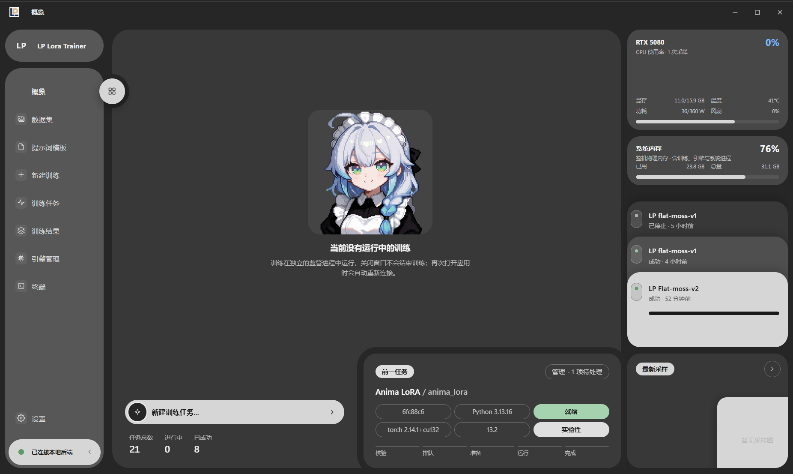
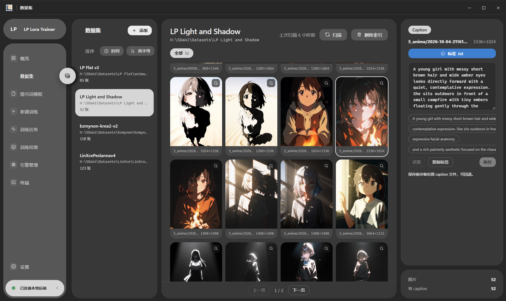
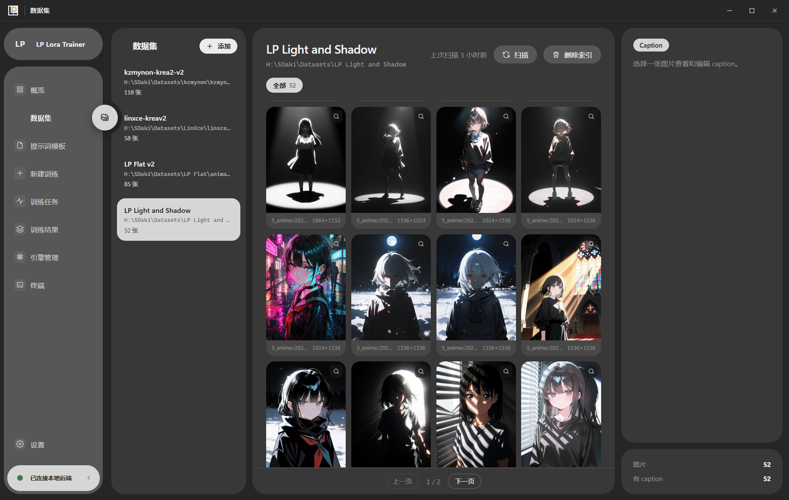
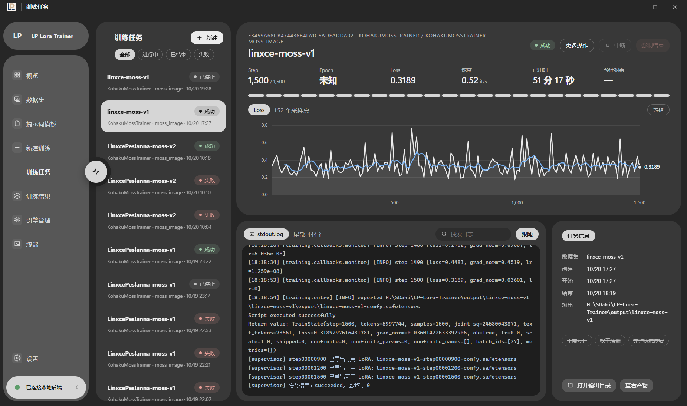
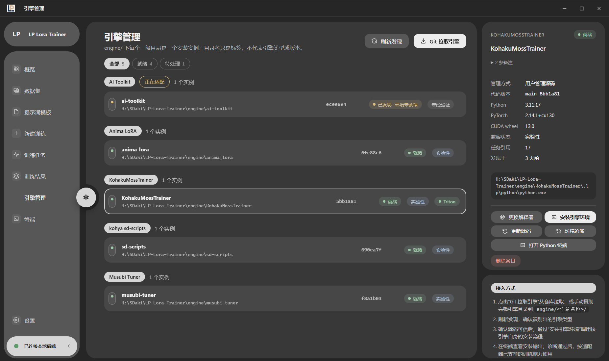

<div align="center">


### LP LoRA Trainer · Windows 桌面 LoRA 训练工作站

一个独立运行的 LoRA 训练桌面应用。产物主要面向 ComfyUI，但不依赖、不安装、也不启动 ComfyUI。


[English](README.md) · [简体中文](README.zh-CN.md)

</div>

## 功能

- **多引擎训练**：把引擎源码放进 `engine/`，扫描识别后安装环境即可训练；不同版本可并存，任务绑定提交时所用的安装实例。
- **数据集管理**：登记数据目录并扫描图片，按问题类型筛选样本，逐张查看与编辑 caption（覆盖前自动备份）。
- **参数与配置**：按所选引擎与底模给出可用参数，可按中文名或引擎键名搜索并跳转，提交前预览最终原生配置与启动命令。
- **训练监控**：实时查看步数、Loss、速度与日志，队列按单 GPU 顺序执行。
- **任务控制**：取消排队、中断或强制结束；后台失联的任务会显式标记，需人工核实后放行。
- **结果与交付**：登记训练产物与采样图，校验文件完整后发布到 ComfyUI 的 LoRA 目录，且不覆盖已有文件。

## 界面预览

### 概览

最近任务、训练队列和引擎环境状态；启用监控后显示 GPU 卡片。



### 数据集浏览

已登记目录、扫描结果和分页缩略图；选择图片后可查看或编辑 caption。扫描只建立应用索引，不会把数据集复制进应用目录。



### 新建训练

选择底模类型、引擎实例与数据集，可搜索参数并直接跳到对应字段；右栏实时显示该引擎的原生配置，参数暂存按「引擎 × 底模类型 × 底模」各存一份。右上角「初始化参数」会把当前引擎与底模的参数整体恢复为引擎默认值，任务名称、路径、数据集与底模选择保持不变。



### 训练任务监控

步数、Loss、速度与耗时，旁边是原始日志；Loss 曲线带滑动平均线。暂停（黄色）向引擎请求正常停止并尽量保存可续训状态，继续（蓝色）从保存点创建新的续训任务；强制结束仍受任务状态与进程监管约束。



### 引擎管理

`engine/` 下每个一级目录是一个安装实例，目录名只是标签；右侧面板显示解释器、环境策略、Triton 可用性与对应操作。



## 典型流程

1. 在引擎管理页扫描并确认 `engine/` 下的可信引擎源码，安装并诊断独立环境。
2. 在数据集页登记数据目录并扫描图片，确认样本和 caption。
3. 在新建训练页选择就绪引擎、底模与数据集，检查参数与原生配置预览后提交。
4. 在训练任务页跟踪进度与日志；结束后到结果页确认模型并按需发布。

## 引擎支持与限制

| 引擎 | 当前支持 |
| --- | --- |
| Kohya / sd-scripts | SD1 / SD2 / SDXL 的单卡 LoRA CLI 训练，含配置生成、日志解析与产物登记。 |
| Musubi Tuner | 缓存流水线（latents → 文本编码器 → 训练）与 13 种架构的单卡 LoRA 训练。 |
| KohakuMossTrainer / Anima LoRA | MOSS-Image 与 Anima LoRA 训练，含预览图、checkpoint 与 loss 上报。 |
| AI Toolkit | 静态发现、实例/版本管理、环境诊断与其适配安装流程；**训练提交尚未实现**。 |

Kohya 与 Musubi 的训练链路由真实子进程 + 模拟引擎的自动化测试覆盖，但**尚未**用真实 GPU、模型和上游引擎做端到端验证。任意上游版本不保证可用，中断后不保证 checkpoint 完整。训练参数开启「保存训练状态」后，Anima、Kohya、Musubi 与 KohakuMoss 可暂停并从状态保存点继续（任务页「继续」）；没有保存状态时无法恢复，强制结束仍可能留下不完整文件。

应用不替用户下载、更新或删除引擎主仓库。clone/复制源码后，无需先绑定 Python，直接在引擎页点「安装引擎环境」：应用准备项目内 uv，再调用该引擎自己的安装流程，终端实时显示并持久化日志。安装结束后自动发现并保存解释器、执行诊断并回写状态；诊断未通过不会显示成功。

## 安装与更新

```bat
install.cmd   :: 自举 uv → 取 CPython → 建 .venv → 安装依赖 → 调用 build.cmd
build.cmd     :: 构建前端 → 构建 python_runtime → 编译 EXE → 自检
update.cmd    :: 从 git 快进更新；用户数据、引擎与运行时一律不动
start.cmd     :: 用 python_runtime 启动桌面窗口（也可直接双击 LP-Lora-Trainer.exe）
```

**前置条件**（仅构建机需要）：Windows x64、Node.js 20+、.NET Framework 4.x（`csc.exe`）、Git，以及可访问 GitHub 与 PyPI 的网络。**不需要预装 Python** —— `install.cmd` 会用项目内的 uv 取一份 CPython。

仓库只含源码：`python_runtime/`、`frontend/dist/`、`runtime/`、`engine/*` 都在 `.gitignore` 中，clone 之后先用 `install.cmd` 或 `build.cmd` 构建一次。

`update.cmd` 只更新被 git 跟踪的源码：`data/`、`output/`、`engine/*`、`runtime/`、`python_runtime/`、`frontend/dist/` 保持原样。若已跟踪源码存在本地修改，脚本会**拒绝执行**；`--check` 只报告有哪些更新、不改动任何文件；`--rebuild` 会在更新后按需重建前端与启动器。

## 打包发行包（维护者）

`scripts\pack_delivery.cmd` 默认在 `_delivery` 下生成两个**无 `.git` 的发行目录**：

```bat
scripts\pack_delivery.cmd
scripts\pack_delivery.cmd D:\LP-Delivery
scripts\pack_delivery.cmd D:\LP-Delivery -Engines anima_lora,musubi-tuner
scripts\pack_delivery.cmd D:\LP-Delivery -Engines none
scripts\pack_delivery.cmd -ListEngines
```

- `LP-Lora-Trainer-core`：程序、`python_runtime/`、`frontend/dist/`、应用源码；不含引擎。
- `LP-Lora-Trainer-full`：core + 选中的 `engine/<名称>/` 及其 `.lp` 环境。
- `-Engines` 按目录名选择，默认全部；`none` 只生成 core。每个包都会生成中文 `README-FIRST.md`，写明随包引擎、GPU/驱动要求、首次启动与更新策略。
- release 包排除 `.git`、`data/`、`output/`、日志、缓存、`node_modules/` 和 `docs/`；发行包不能用 `update.cmd` 更新，更新方式是用新版发行包替换程序文件并保留 `data/`、`output/`、`engine/`。git 快进更新只适用于完整源码目录。

## 便携运行（Windows x64，无需系统 Python）

应用自带完整 `python_runtime/`，不是依赖系统 Python 的 `.venv`。把**整个交付目录**复制到另一台 Windows x64 机器，双击 `LP-Lora-Trainer.exe` 即可，无需 Python、pip、Node.js 或任何激活步骤。

```text
LP-Lora-Trainer/
├─ LP-Lora-Trainer.exe         # 桌面入口，按自身位置定位解释器
├─ start.cmd / start-api.cmd   # 命令行入口（API-only 亦可）
├─ update.cmd / check-runtime.cmd
├─ python_runtime/             # 完整 CPython、标准库、应用依赖与许可证
│  ├─ python.exe
│  ├─ python312._pth           # 只有相对路径；无 site、环境变量与用户目录
│  └─ runtime-manifest.json    # 记录的 Python 与依赖版本
├─ app/, desktop/, supervisor/, adapters/
├─ frontend/dist/              # 构建好的 UI 必须随应用一起拷走
├─ scripts/
└─ engine/                     # 引擎源码与各引擎自己的环境
```

所有入口**永不回退到系统 Python**：后端与 supervisor 用同一个内置解释器启动子进程，所以整个目录换盘后不需要修路径。内置版本为 CPython 3.12 加应用依赖闭包（见 `python_runtime/runtime-manifest.json`），升级意味着重建。

**桌面窗口打不开时**：缺少 .NET/WebView 桥接会切到**终端 + 浏览器**模式并打开 `http://127.0.0.1:5900`，日志写在 `runtime/console.log`；关闭该终端即结束后端与 supervisor。`--browser` 可强制此模式。

```powershell
.\LP-Lora-Trainer.exe
.\LP-Lora-Trainer.exe --data-root "H:\LPData"
.\python_runtime\python.exe scripts\check_runtime.py
```

默认地址 `http://127.0.0.1:5900`。关闭窗口不会结束 API、supervisor 或正在进行的训练；请在任务页中断/强制结束，并在无活动任务时用设置页的「退出后端与 supervisor」。

### 换目录 / 换电脑

先停止训练并退出后台进程，再整体复制目录。便携运行时不需要激活，也不需要修路径。

**引擎环境同样可搬迁**：除 AI Toolkit 外，引擎都把依赖装进 `engine/<名称>/.lp/python` 的复制版 CPython（`embedded` 策略）——没有 `pyvenv.cfg`、没有 venv 的 `activate` / `Scripts\python.exe`，只有相对路径的 `pythonXY._pth` 定位 `Lib` / `Lib/site-packages` / `DLLs`。pip 生成的 console-script（例如 `kogine.exe`）仍位于 `Scripts` 且内嵌绝对解释器路径，整体复制后可能失效；LP 启动不依赖它：KohakuMossTrainer 在启动器指向的解释器不再匹配时，改用当前绑定解释器调用 kogine 入口，其他引擎则直接由解释器运行入口脚本。editable 安装会改写成 `._pth` 里的相对导入根。移动后引擎记录按目录名认领，环境 id 不含绝对路径，清单与绑定继续匹配。旧的 `venv` / `.venv` 环境可在引擎页重装，或用 `scripts/migrate_env_to_embedded.py` / `scripts/transfer_env_to_embedded.py` 转换。

数据库里登记的引擎、解释器、数据集、模型、输出与发布目标可能仍是绝对路径，需要在界面里重新确认；不要批量替换历史任务固定的绑定或原生配置。

### 接入引擎

```text
engine/
├─ kohya_ss/          # 内含 sd-scripts/，也可直接放 sd-scripts 源码
├─ musubi-tuner/      # 缓存流水线 + 训练（13 种架构）
├─ KohakuMossTrainer/ # MOSS-Image / Anima LoRA
└─ ai-toolkit/        # 环境安装/管理；训练适配尚未实现
```

1. 把可信引擎源码放进 `engine/<任意实例名>/`。
2. 引擎页重新扫描并确认识别出的类型。
3. 点「安装引擎环境」并确认信任来源；不需要先选 Python。
4. 在终端观察或停止安装。流程会自动发现并保存解释器，再做诊断；只有实现训练适配且诊断通过的引擎才能提交任务。
5. 添加并扫描数据集、选择本地底模，然后在新建训练页校验并提交。

Kohya 数据集目前要求图片直接位于登记目录；输出目录不得位于引擎源码、数据集、底模或应用 `data/` 内，每个任务有独立输出子目录。

## 数据与设置

- `data/state.sqlite`：引擎、数据集、任务与产物的索引；后端启动时及每 6 小时清理已删除文件的产物记录（只删索引，不删文件）。
- `data/jobs/<task-id>/`：配置、绑定、命令记录、日志、指标与产物记录。
- `data/manifests/`：环境诊断记录。
- `data/cache/`：缩略图等缓存。
- `data/installations/<session-id>/output.log`：完整安装日志。
- `runtime/desktop.log`、`runtime/backend.log`：桌面错误与后端启动日志。
- `runtime/uv/`：项目内 uv、基础 Python 与下载缓存。
- GPU 监控默认关闭；开启后用低频 `nvidia-smi` 查询。

服务运行时不能切换 `data_root`：停止训练与后台服务、复制数据后，用 `--data-root` 指向新目录。

## 开发

```powershell
python -m venv .venv
.\.venv\Scripts\python.exe -m pip install -e ".[desktop,test]"
npm.cmd --prefix frontend ci
npm.cmd --prefix frontend run build
.\.venv\Scripts\python.exe scripts\build_python_runtime.py --replace
powershell -ExecutionPolicy Bypass -File scripts\build_launcher.ps1
```

`build_python_runtime.py` 复制真实 CPython、标准库、原生库与应用依赖闭包，保留许可证与版本清单，排除虚拟环境解释器、editable 映射、pip 与训练依赖；加 `--replace` 会先自检新运行时并把旧的留作备份。维护细节见 `scripts/README.md`。

## 验证

```powershell
.\python_runtime\python.exe -m unittest discover -s tests -v
.\python_runtime\python.exe scripts\check_runtime.py
npm.cmd --prefix frontend run build
```

测试覆盖真实 HTTP、安装子进程、日志、失败重试、进程树停止、环境路径回写与诊断；GPU 与依赖诊断使用固定数据，不下载大型训练包。便携运行时不带构建工具，因此有三个构建专用测试在便携环境中跳过。

## 致谢

本项目是围绕他人训练代码的工作台：不内嵌、也不重写这些训练器，只负责发现、管理环境并调用它们自己的入口。

- **[kohya-ss / sd-scripts](https://github.com/kohya-ss/sd-scripts)** —— 本应用多个引擎沿用的 LoRA 训练基础；数据集配置、键名与 CLI 约定都源自它。
- **[kohya-ss / kohya_ss](https://github.com/bmaltais/kohya_ss)** —— 应用调用其官方安装器完成环境部署。
- **[kohya-ss / musubi-tuner](https://github.com/kohya-ss/musubi-tuner)** —— 缓存后再训练的流水线与 13 种架构支持。
- **[ostris / ai-toolkit](https://github.com/ostris/ai-toolkit)** —— 引擎发现与其自带 manager 的安装流程。
- **[KohakuMossTrainer](https://github.com/KohakuBlueleaf)** 与 **Anima LoRA** —— MOSS-Image / Anima 训练线，以及 ComfyUI 可读的 kohya 键名布局。
- **[lycoris](https://github.com/KohakuBlueleaf/LyCORIS)** —— 导出元数据中 `ss_network_module` 对应的 LoRA 算法家族。
- **[ComfyUI](https://github.com/comfyanonymous/ComfyUI)** —— 导出 LoRA 的目标运行环境。
- **[FastAPI](https://fastapi.tiangolo.com/)**、**[pywebview](https://pywebview.flowrl.com/)**、**[Vue 3](https://vuejs.org/)**、**[uv](https://github.com/astral-sh/uv)** —— 应用本身的技术栈。

也感谢维护这些上游训练器的作者，以及在真实 GPU、模型与数据集上测试早期版本的用户。

## 许可证

[Apache License 2.0](LICENSE)
